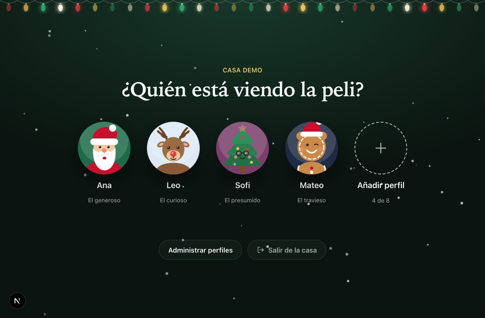
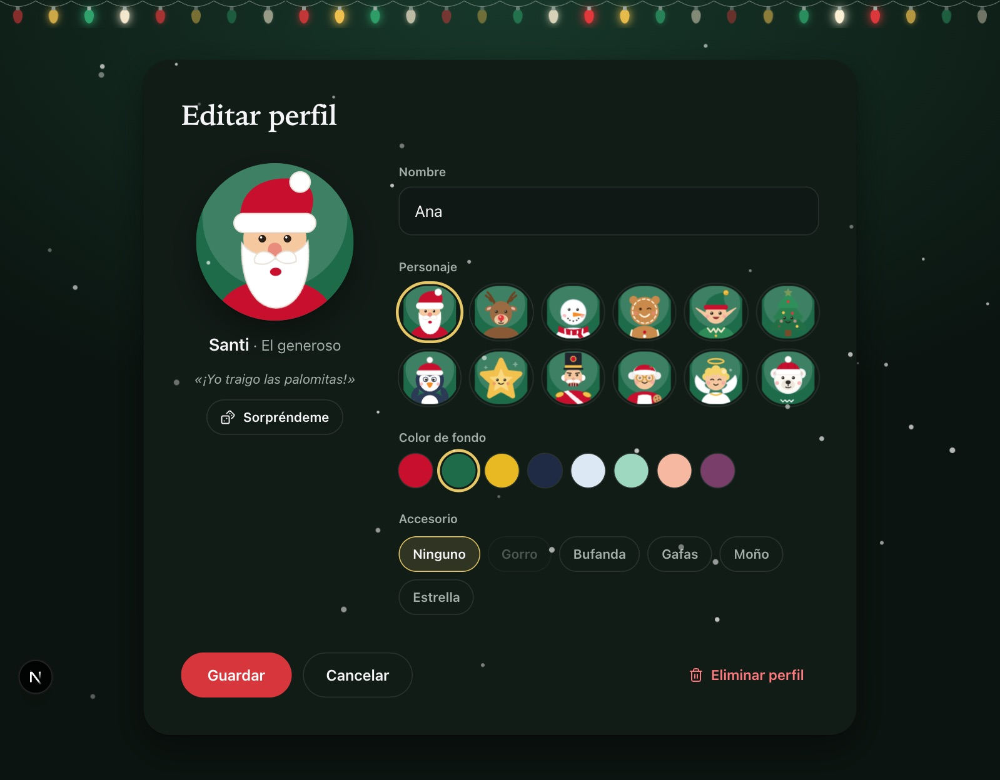
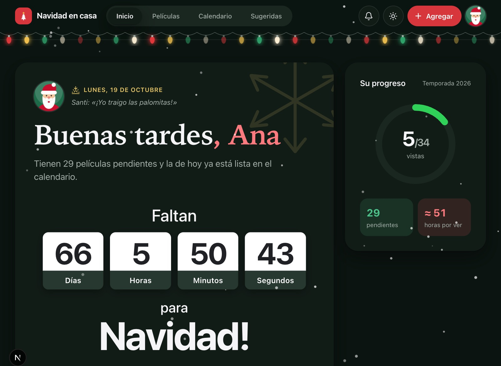
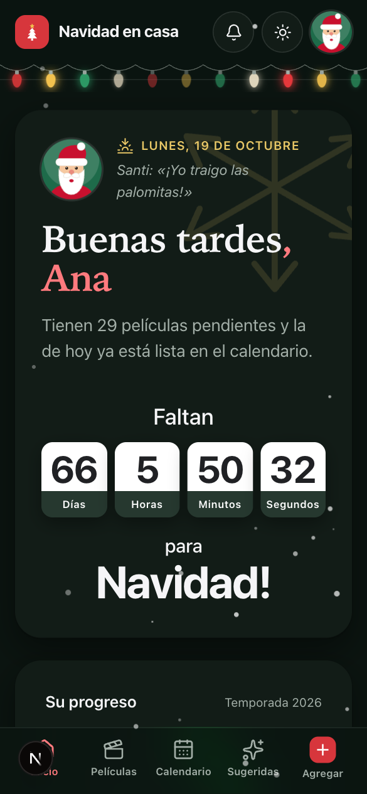
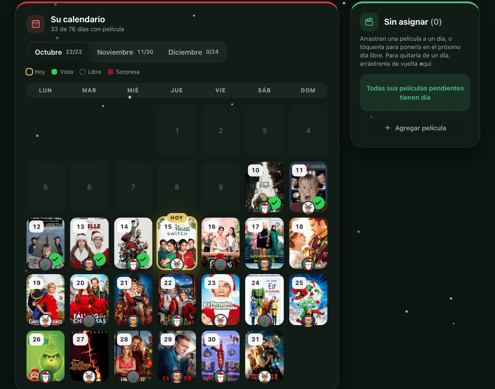
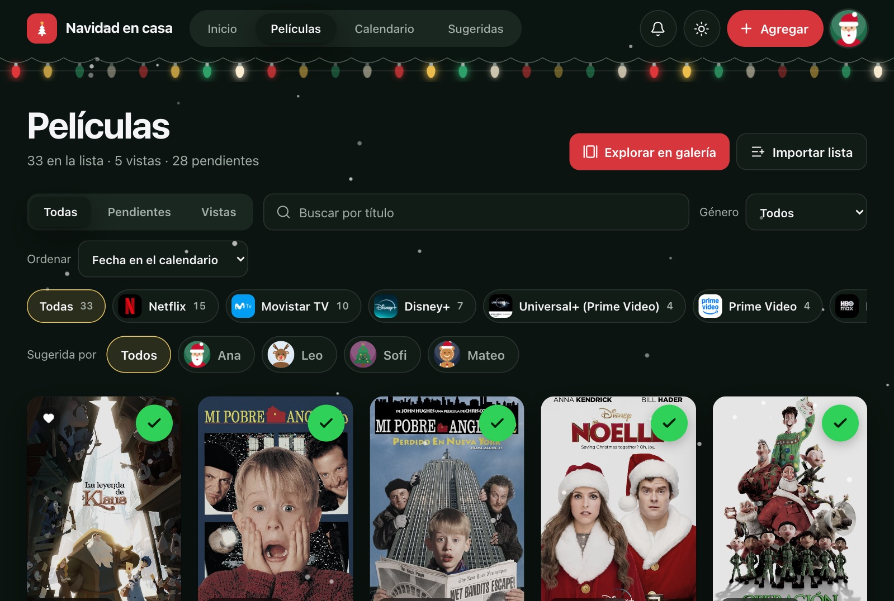
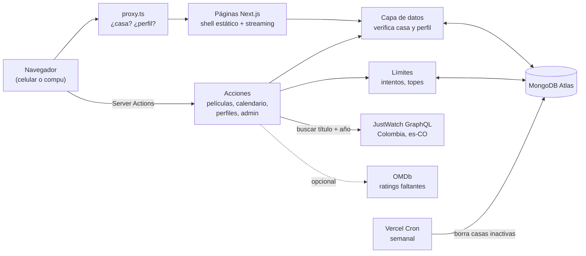
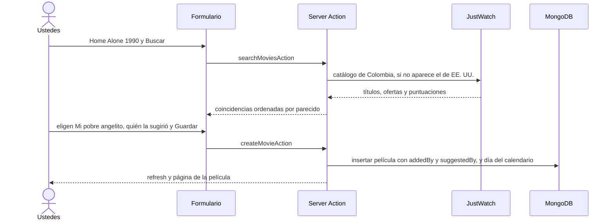
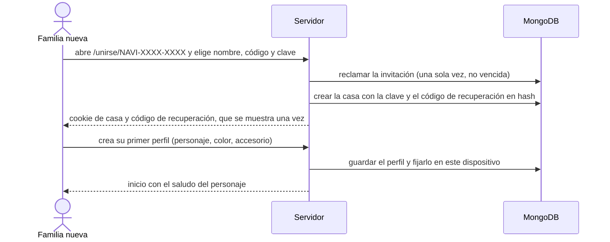
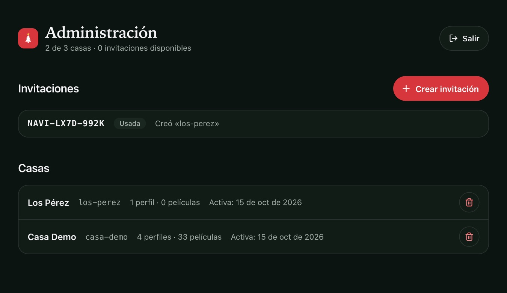

<div align="center">


# Navidad en casa

**Sus películas de Navidad en un solo lugar: dónde verlas en Colombia, cuáles ya vieron y un calendario de adviento con una película por día. Cada casa tiene sus propios perfiles, con avatares navideños.**
Next.js 16 · MongoDB Atlas · datos automáticos de JustWatch, sin IA ni API keys de pago.




</div>

> *Escriben «Home Alone 1990» y la app trae «Mi pobre angelito» con póster, sinopsis, IMDb 7,8, Rotten Tomatoes 66 % y el botón «Ver en Disney+». Y en el calendario queda el avatar de quien la sugirió.*

## Contenido

- [Qué hace](#qué-hace)
- [Casas, perfiles y límites](#casas-perfiles-y-límites)
- [Cómo funciona](#cómo-funciona)
- [Requisitos](#requisitos)
- [Variables de entorno](#variables-de-entorno)
- [Probarlo en local](#probarlo-en-local)
- [Configurar MongoDB Atlas](#configurar-mongodb-atlas)
- [Desplegar en Vercel](#desplegar-en-vercel)
- [Administrar las casas](#administrar-las-casas)
- [Decisiones técnicas](#decisiones-técnicas)
- [Modelo de datos](#modelo-de-datos)
- [Estructura del proyecto](#estructura-del-proyecto)
- [Solución de problemas](#solución-de-problemas)
- [Hoja de ruta](#hoja-de-ruta)
- [Licencia y avisos](#licencia-y-avisos)

## Qué hace

- **Casas y perfiles, como en Netflix o la Switch.** Cada familia tiene su **casa** (su propia lista y calendario) y dentro de ella **perfiles**. Al entrar se pregunta «¿Quién está viendo la peli?»; el perfil elegido queda recordado en ese dispositivo y se usa para saludar y para saber quién hace qué.
- **Avatares navideños con personalidad.** Doce personajes dibujados en SVG (Santi, Rudolfo, Nieves, Jengi, Duli, Pino, Pingu, Estrellita, Cascanueces, Noela, Ángel y Osi), cada uno con su carácter y su frase. Se personalizan con color de fondo y accesorio (gorro, bufanda, gafas, moño, estrella) y hay un botón «Sorpréndeme».
- **Quién agregó, quién sugirió.** Cada película guarda quién la agregó, quién la sugirió (pueden ser personas distintas) y quién la editó por última vez. Se ve en el detalle («Sugerida por Rudolfo · agregada por Ana»), en las tarjetas, en el filtro «Sugerida por» y como un avatar colgando bajo cada puerta del calendario. Con el modo sorpresa, las puertas cerradas no lo muestran para no dar pistas.
- **Agregar con nombre y año.** Busca en JustWatch Colombia y trae el título latinoamericano, el póster, la sinopsis, los géneros, la duración, IMDb, el Tomatómetro (con Certified Fresh) y las plataformas con enlace directo a la película. Todo se puede editar a mano, incluida la opción «Sin plataforma».
- **Sin duplicados.** Si buscan una película que ya tienen, el resultado sale bloqueado con el aviso «Ya lo tienes en tu biblioteca» y un enlace para verla. Se detecta por el id de JustWatch, el de IMDb o título y año, así que también atrapa las escritas a mano. Al importar una lista pasa lo mismo: esas filas quedan desmarcadas.
- **Sugeridas.** Una página con películas navideñas conocidas (clásicas y recientes) que todavía no están en su lista, con sus puntuaciones y plataformas en Colombia. Al tocar una película se abre su detalle (sinopsis, géneros, puntuaciones, todas las plataformas y el tráiler) antes de agregarla; también se agregan con un toque desde la tarjeta. Al final, «Cargar más sugeridas» trae otras películas navideñas (buscadas en JustWatch, sin repetir las que ya salieron ni las que ya tienen), y se puede filtrar por plataforma u ordenar por IMDb, Rotten Tomatoes o año.
- **Importar una lista completa.** Pegan «Título (año)» una por línea, revisan las coincidencias dudosas y guardan todas de una vez.
- **Galería.** El botón «Explorar en galería» (o el ícono de cada tarjeta) abre un carrusel casi a pantalla completa para recorrer sus películas: carátula, año, puntuaciones y plataformas de la que está al centro. Se navega con las flechas, con ← → del teclado o deslizando, y sigue el orden y los filtros de la lista.
- **Marcar como vista** con un check verde animado y un sonido de campana (Web Audio, sin archivos). También tienen favoritas, calificación propia de 1 a 5 estrellas y notas.
- **Calendario de adviento.** Empieza «Desde hoy», el 1 de octubre, el 1 de noviembre, el 1 de diciembre, en la Novena (16–24 dic) o en una fecha propia, y termina el 24 de diciembre. Las películas se arrastran a cada día. Tiene modo sorpresa (los días futuros quedan cerrados como regalos), «Repartir automáticamente» (asigna todas las pendientes aunque cambien el rango de fechas), «Mezclar» y «Vaciar» con opción de deshacer. Los contadores de arriba distinguen días libres de películas sin día, y las películas vistas que no tienen día aparecen en el panel lateral para que ninguna quede escondida. Al abrir una puerta se ve la película en grande: póster, sinopsis completa, puntuaciones y todas las plataformas con su enlace.
- **Inicio que saluda** a quien está viendo («Buenas noches, Ana») con su personaje y su frase, muestra una cuenta regresiva hasta la medianoche de Navidad (hora de ustedes, con días, horas, minutos y segundos) y la película que toca hoy.
- **Diseño navideño:** logo de árbol de Navidad, modo claro y oscuro con transición de círculo, nieve, guirnalda de luces, tipografía de Apple (SF Pro / New York), pie de página con créditos y vista móvil con barra de pestañas.

<div align="center">

</div>

<div align="center">

</div>

<div align="center">

&nbsp;&nbsp;

</div>

<div align="center">

</div>

## Casas, perfiles y límites

**Una casa** es lo que se compra con una invitación: tiene un nombre, un **código** (por ejemplo `casa-montano`) y una **clave** que comparte toda la familia. **Un perfil** es cada persona dentro de la casa; no tiene clave, se elige en la pantalla de perfiles (hasta 8 por casa). El perfil elegido se guarda en una cookie del dispositivo y se cambia desde el menú del avatar, arriba a la derecha.

**Crear una casa** solo se puede con una **invitación** de un solo uso que genera quien administra el servicio (ver [Administrar las casas](#administrar-las-casas)). Con ella se abre `/unirse/NAVI-XXXX-XXXX`, se elige nombre, código y clave, y la app muestra **una sola vez** un código de recuperación. Si olvidan la clave, `/recuperar` la restablece con ese código (y entrega uno nuevo). No hay correos ni cuentas de terceros.

| Límite | Valor | Para qué |
|---|---|---|
| Casas en total (`HOME_CAP`) | 25 | Que el servicio no crezca sin que su dueño lo decida |
| Perfiles por casa | 8 | |
| Películas por casa | 150 | ~3 KB cada una: 25 casas llenas ≈ 11 MB, muy por debajo de los 512 MB del plan gratis de Atlas |
| Claves o códigos de recuperación fallidos | 5 cada 15 min por IP y casa | Frenar la adivinanza de claves |
| Invitaciones fallidas | 5 por hora por IP | Frenar la adivinanza de invitaciones |
| Búsquedas en JustWatch/OMDb | 30 por hora por casa | Proteger la cuota gratis de OMDb |
| Invitaciones | un solo uso, vencen a los 14 días, 8 caracteres | |
| Casas sin actividad | se borran tras 12 meses (cron semanal) | Limpieza automática |

Otras defensas: las claves se guardan con `scrypt` y comparación en tiempo constante; el error de entrada es el mismo exista o no el código de la casa; cada acción del servidor vuelve a comprobar la sesión **y** que el perfil pertenezca a esa casa; y una casa borrada deja de poder escribir aunque su cookie siga vigente.

## Cómo funciona

La idea clave: **la app no guarda una copia "oficial" de nada externo**. Cuando agregan una película, el servidor le pregunta a JustWatch por el título y el año y les muestra las coincidencias. Lo que eligen se guarda en MongoDB y queda editable. El botón «Actualizar datos» vuelve a consultar los ratings y la disponibilidad, que cambian con el tiempo, sin tocar el título ni las notas que ustedes pusieron.

La entrada tiene **dos pasos**: primero la casa (código + clave) y luego el perfil. Cada paso es una cookie firmada distinta.







## Requisitos

| Qué | Para qué | Costo |
|---|---|---|
| **Node.js 22+** y **pnpm 10** | Correr, probar y construir | Gratis |
| **MongoDB Atlas** (clúster M0) | Guardar casas, perfiles, películas y calendarios | Gratis |
| **Vercel** (plan Hobby) | Publicarla en internet y correr la limpieza semanal | Gratis |
| JustWatch | Pósters, sinopsis, ratings y plataformas en Colombia | Gratis, sin clave |
| OMDb *(opcional)* | Completar IMDb o Rotten Tomatoes cuando JustWatch no los trae | Gratis hasta 1.000 consultas al día |

## Variables de entorno

Copien [`.env.example`](.env.example) a `.env.local`, que git ignora.

| Variable | Obligatoria | Descripción |
|---|:-:|---|
| `MONGODB_URI` | ✅ | Cadena de conexión de Atlas (`mongodb+srv://…`). Ver [Configurar MongoDB Atlas](#configurar-mongodb-atlas). |
| `MONGODB_DB` | | Nombre de la base. Por defecto `christmas-movies`. |
| `AUTH_SECRET` | ✅ | Firma las cookies de sesión (mínimo 32 caracteres): `openssl rand -base64 32`. |
| `ADMIN_PASSWORD` | ✅ | Clave del panel `/admin`, donde se crean invitaciones. Si falta, se usa `APP_PASSWORD`. |
| `APP_PASSWORD` | solo al migrar | Clave de la **primera casa**, la que crea `pnpm migrate:homes` a partir del dashboard de antes. Después ya no se usa para entrar. |
| `HOME_CAP` | | Máximo de casas. Por defecto 25; `0` cierra los registros. |
| `CRON_SECRET` | ✅ en Vercel | Protege la limpieza semanal: Vercel la envía como `Authorization: Bearer …`. `openssl rand -base64 32`. |
| `OMDB_API_KEY` | | Clave gratis de [omdbapi.com](https://www.omdbapi.com/apikey.aspx). |

> Los secretos viven solo en `.env.local` y en el panel de Vercel. **Nunca** se versionan.

## Probarlo en local

```bash
git clone https://github.com/jvrmmora/christmas-movies-select.git
cd christmas-movies-select
pnpm install
cp .env.example .env.local   # completen MONGODB_URI, AUTH_SECRET y ADMIN_PASSWORD
pnpm dev                     # http://localhost:3000
```

**Ver la app llena sin tocar sus datos.** Esto carga una casa con cuatro perfiles, 33 películas acreditadas a ellos, 5 vistas y un calendario armado, en una base aparte, `christmas-movies-demo`. El script se niega a escribir si el nombre de la base no contiene `demo`.

```bash
pnpm demo                                      # cargar datos de demo
MONGODB_DB=christmas-movies-demo pnpm dev      # abrir la app con esos datos
# entren con el código de casa «casa-demo» y la clave «navidad», y elijan un perfil
pnpm demo --limpiar                            # borrarlos
```

**Empezar de cero en una base nueva.** No hay casas todavía, así que se crean desde el panel:

1. Abran `http://localhost:3000/admin`, entren con `ADMIN_PASSWORD` y pulsen **Crear invitación**.
2. Abran el enlace `/unirse/NAVI-…`, elijan nombre, código y clave, y guarden el código de recuperación.
3. Creen el primer perfil y ya pueden agregar o importar películas.

**Convertir el dashboard anterior (una sola clave) en la primera casa.** Conserva todas las películas y el calendario y no reescribe ningún documento: la casa toma el identificador `household`, que ya llevaban. Los nombres del saludo viejo («Ana y Leo») se convierten en perfiles. Es idempotente.

```bash
APP_PASSWORD="la clave de siempre" pnpm migrate:homes --slug casa-montano --name "Casa Montaño"
```

> Ensáyenlo primero en la base de demo: `MONGODB_DB=christmas-movies-demo APP_PASSWORD=… pnpm migrate:homes --slug demo --name Demo`.

**Cargar la lista inicial de la casa original** (la lista personal del autor), si se clona de cero. Es idempotente: las películas que ya existen se saltan. Con `--slug` se carga en otra casa.

```bash
pnpm seed                        # casa migrada (household)
pnpm seed --slug casa-montano    # una casa en concreto
```

**Pruebas y chequeos:**

```bash
pnpm test        # 64 pruebas: calendario y reparto automático, duplicados, saludo, formato, JustWatch, claves, invitaciones, límites, créditos de películas, avatares
pnpm lint
pnpm typecheck
pnpm build
```

## Configurar MongoDB Atlas

1. Creen una cuenta en [cloud.mongodb.com](https://cloud.mongodb.com) y un clúster **M0** (gratis).
2. En **Database Access**, creen un usuario con el rol `readWrite` solo sobre la base `christmas-movies`. No usen `root`.
3. En **Network Access**, agreguen `0.0.0.0/0`. Vercel no tiene IPs fijas, así que es necesario; la protección está en el usuario y la clave.
4. En **Connect → Drivers**, copien la cadena `mongodb+srv://…`, pongan la clave del usuario y péguenla en `MONGODB_URI`.

Los índices (casas por código, perfiles por casa, título + año únicos por casa, temporada del calendario, y la expiración automática de los contadores de intentos) se crean solos la primera vez que la app se conecta.

## Desplegar en Vercel

> ⚠️ **Si ya tienen datos de la versión de una sola clave, corran `pnpm migrate:homes` contra esa base _antes_ de desplegar.** Sin casas, nadie puede entrar. Hagan también una copia de la base en Atlas (**Backup** o `mongodump`).

**Desde GitHub (recomendado, cada push despliega solo):**

1. En [vercel.com/new](https://vercel.com/new), importen el repositorio `jvrmmora/christmas-movies-select`. Vercel detecta Next.js; no hay que cambiar nada del build.
2. En **Environment Variables**, agreguen `MONGODB_URI`, `MONGODB_DB`, `AUTH_SECRET`, `ADMIN_PASSWORD`, `CRON_SECRET`, `HOME_CAP` (opcional) y, si la usan, `OMDB_API_KEY`.
3. **Deploy.** Abran la URL `*.vercel.app`, entren con el código de su casa y su clave, y elijan perfil.

**Desde la terminal:**

```bash
npm i -g vercel
vercel login
vercel link
vercel env add MONGODB_URI production    # repetir con cada variable
vercel deploy --prod
```

El archivo [`vercel.json`](vercel.json) programa la limpieza semanal (lunes, 8:00 UTC) en `/api/cron/cleanup`, que borra las casas sin actividad en 12 meses (nunca la casa original) y las invitaciones vencidas hace más de un mes.

> En Vercel las cookies son `Secure`: la de la casa dura 30 días y la del perfil un año. Para cerrar todas las sesiones de una vez, cambien `AUTH_SECRET` y vuelvan a desplegar.

## Administrar las casas

`/admin` (con `ADMIN_PASSWORD`) es el panel de quien opera el servicio:

<div align="center">

</div>

- **Invitaciones:** crear (se copia el código o el enlace para enviarlo), ver si están disponibles, usadas o vencidas, y revocar las que no se han usado.
- **Casas:** cuántas hay frente al tope, cuántos perfiles y películas tiene cada una y cuándo fue su última actividad. Se pueden borrar escribiendo su código para confirmar; se elimina todo lo suyo.

## Decisiones técnicas

| Decisión | Por qué |
|---|---|
| **JustWatch GraphQL con `language: "es-CO"`** en vez de IA o TMDB | Trae los títulos como se conocen en Colombia («Mi pobre angelito», no «Solo en casa»), las plataformas del país con enlace directo, IMDb y el Tomatómetro, sin clave ni costo. Es una API no oficial, así que todo queda editable y hay un botón para volver a consultar. |
| **Respaldo al catálogo de EE. UU.** | Algunos títulos («Aquella Navidad», de Netflix) no aparecen en el buscador de Colombia, aunque sí tienen datos y ofertas colombianas. |
| **Cache Components de Next 16**: shell estático + `<Suspense>` | Cada página carga al instante con esqueletos y los datos de Mongo llegan en streaming. Las mutaciones llaman `refresh()` y la UI responde al momento con `useOptimistic`. |
| **Casa (clave) → perfil (sin clave)**, ambos en cookies JWT firmadas con `jose` | Se parece a una cuenta de Netflix: la familia comparte una clave y cada persona elige su perfil. No hay cuentas por persona ni correos. `proxy.ts` hace el control rápido en dos pasos, y cada lectura y cada Server Action vuelve a verificar la sesión. |
| **`ownerId` pasó a ser el id de la casa** | Todos los documentos ya lo llevaban; así la casa original conserva su identificador (`household`) y migrar no reescribe ningún dato. |
| **Registro solo por invitación** | Es la defensa más fuerte contra que alguien llene la base: nadie crea una casa sin un código de un solo uso que usted generó. Complementa los topes y los límites de intentos. |
| **Contadores de intentos en MongoDB con índice TTL** | Sin Redis ni servicios extra: cada ventana se borra sola al vencer. La lógica del límite es independiente del almacenamiento, por eso tiene pruebas con un almacén en memoria. |
| **Avatares en SVG dentro del código** | Sin subir imágenes no hay almacenamiento, costos ni contenido que moderar; cada avatar guarda solo `{personaje, color, accesorio}`, validado contra una lista cerrada. |
| **La hora se calcula solo en el navegador** | El saludo, «Hoy toca» y la cuenta regresiva usan la zona horaria de ustedes, no la del servidor (UTC). Así se evitan errores de hidratación. |
| **dnd-kit** con colisión por puntero | El arrastre funciona con mouse y con el dedo (mantener presionado). Gana el día que está debajo del puntero, no el que más se superpone. Tocar un día vacío abre la lista como alternativa accesible. |
| **Sonidos sintetizados con Web Audio** | La campana, el *tick* y el *jingle* pesan 0 KB, no hay archivos que descargar y se silencian desde la cabecera. |
| **Logos oficiales** de IMDb, Rotten Tomatoes y plataformas | IMDb y Rotten Tomatoes están en `public/logos/` (Wikimedia Commons). Los de las plataformas son los íconos que entrega JustWatch. |

## Modelo de datos

```text
homes       { _id, slug (único), name, passwordHash, recoveryHash, inviteCode, createdAt, lastActiveAt }
profiles    { _id, homeId, name, avatar{character, bg, accessory}, createdAt }
invites     { _id (código), createdAt, expiresAt, usedAt, usedByHomeId }
rate_limits { _id (clave del límite), count, expiresAt }   · TTL: se borra sola
movies      { ownerId (= id de la casa), title, originalTitle, year, posterUrl, backdropUrl, synopsis, genres[],
              runtimeMinutes, trailerUrl, ratings{imdb, rottenTomatoes, certifiedFresh},
              streaming[{provider, name, logoUrl, type: flatrate|free|ads|rent|buy, url}],
              externalIds{imdbId, tmdbId, justwatchId}, watched, watchedAt, favorite,
              myRating, notes, source: auto|manual, lastSyncedAt,
              addedBy, suggestedBy, updatedBy }   · ids de perfil; único: ownerId+title+year
calendars   { ownerId, season, preset, startDate, endDate (24 dic), assignments{ "YYYY-MM-DD": movieId }, surprise }
settings    { ownerId, displayName }   · solo lo lee la migración, para crear los primeros perfiles
```

## Estructura del proyecto

```
src/
├── proxy.ts                 # sin casa → /login · con casa y sin perfil → /perfiles
├── app/
│   ├── (app)/               # inicio, películas (lista, detalle, nueva, editar, importar), calendario, sugeridas
│   ├── login/ unirse/ recuperar/   # entrar con código y clave · crear casa con invitación · recuperar acceso
│   ├── perfiles/            # «¿Quién está viendo?», editor de perfiles
│   ├── admin/               # invitaciones y casas
│   ├── api/cron/cleanup/    # limpieza semanal (Vercel Cron)
│   ├── salir/               # limpia la sesión de una casa que ya no existe
│   └── globals.css          # paleta navideña (tokens claro/oscuro) y animaciones
├── actions/                 # Server Actions: auth, home, profiles, admin, movies, calendar, suggestions
├── components/              # dashboard, movies, advent (calendario), avatars, profiles, auth, shell, ui
└── lib/
    ├── metadata/            # JustWatch (búsqueda y mapeo) y OMDb
    ├── dal.ts · db.ts       # acceso a datos con verificación de sesión · cliente de Mongo
    ├── jwt.ts · session.ts  # cookies de casa, perfil y admin
    ├── password.ts · invite.ts   # scrypt · códigos de invitación y recuperación
    ├── limits.ts · rate-limit.ts # topes y límites de intentos
    ├── avatar.ts · credits.ts    # personajes, colores y accesorios · texto «sugerida por…»
    ├── calendar.ts          # rangos, celdas del mes, reparto automático
    ├── library-match.ts     # ¿ya está en la biblioteca? (JustWatch id, IMDb id, título + año)
    ├── suggestions.ts       # catálogo navideño y caché de sugeridas
    └── *.test.ts            # pruebas con Vitest
scripts/                     # seed-list (lista inicial), demo (datos de demostración) y migrate-homes
public/logos/                # IMDb y Rotten Tomatoes
docs/                        # logo y capturas del README
```

## Solución de problemas

| Síntoma | Causa probable y arreglo |
|---|---|
| `MongoServerSelectionError` o *timeout* al entrar (en Vercel) | Atlas bloquea la IP. Agreguen `0.0.0.0/0` en **Network Access**. |
| `user is not allowed to do action […]` | El usuario de Atlas no tiene permisos sobre esa base. Denle `readWrite` sobre `christmas-movies` (y sobre `christmas-movies-demo` si usan el modo demo). |
| «Ese código de casa o esa clave no coinciden» | El código o la clave están mal; el aviso es el mismo a propósito. Si olvidaron la clave, usen [Recuperar acceso](#casas-perfiles-y-límites). |
| «Demasiados intentos. Prueba de nuevo en 15 minutos» | Se pasaron de 5 intentos fallidos desde esa red para esa casa. Esperen o cambien de red. |
| Después de desplegar nadie puede entrar | Faltó migrar el dashboard anterior: corran `pnpm migrate:homes` contra la base de producción (ver [Probarlo en local](#probarlo-en-local)). |
| «Ese código de invitación no es válido, ya se usó o venció» | Cada invitación sirve una vez y dura 14 días. Generen otra en `/admin`. |
| «Por ahora no hay lugar para más casas» | Se alcanzó `HOME_CAP`. Súbanlo o borren casas en `/admin`. |
| El cron de limpieza responde 401 | Falta `CRON_SECRET` en Vercel (o no coincide). Agréguela y vuelvan a desplegar. |
| `AUTH_SECRET debe tener al menos 32 caracteres` | Generen uno con `openssl rand -base64 32`. |
| La búsqueda no encuentra una película | Prueben con el título original en inglés, o sin año. Si JustWatch no la tiene (por ejemplo, «In fraganti», 2009), elijan «Agregar sin datos» y completen a mano. |
| «Sugeridas» dice que no pudo cargar | JustWatch no respondió. Recarguen en un momento; el resultado bueno se guarda en caché unas horas. |
| Una película no muestra IMDb o Rotten Tomatoes | JustWatch no lo tiene. Configuren `OMDB_API_KEY` y usen «Actualizar datos», o escríbanlo en «Editar». |
| `vitest` falla con «Cannot find native binding» | `node_modules` se instaló con otra arquitectura (por ejemplo, Node x64 en un Mac M1). Corran `pnpm install --frozen-lockfile` con el Node que usan ahora. |
| No suena nada | El navegador solo permite audio después del primer toque. Revisen también que la campana de la cabecera no esté tachada (silencio). |

## Hoja de ruta

- [x] Lista con datos automáticos, importación y edición completa
- [x] Vistas, favoritas, calificación y notas
- [x] Calendario de adviento con arrastrar y soltar y modo sorpresa
- [x] Modo claro/oscuro, nieve, sonidos y vista móvil
- [x] Sugeridas y bloqueo de duplicados
- [x] Casas con invitación, perfiles y avatares navideños, con quién agregó y sugirió cada película
- [x] Límites anti-abuso y limpieza de casas inactivas
- [ ] PIN opcional por perfil
- [ ] Calificación y favoritas por perfil (hoy son de la casa)
- [ ] Recordatorio diario de «Hoy toca» (Vercel Cron + correo o push)
- [ ] Actualización automática semanal de plataformas y ratings

## Licencia y avisos

Código bajo licencia [MIT](LICENSE).

Datos de disponibilidad de [JustWatch](https://www.justwatch.com/co). IMDb, Rotten Tomatoes, Netflix, Disney+, Prime Video, HBO Max, Movistar TV y demás nombres y logos son marcas de sus dueños; se usan solo para identificar el servicio. Este proyecto **no está afiliado** a ninguno de ellos. Los pósters y las sinopsis pertenecen a sus estudios. Los personajes de los avatares son dibujos originales de este proyecto.
