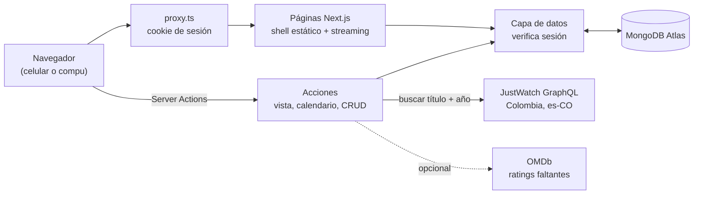
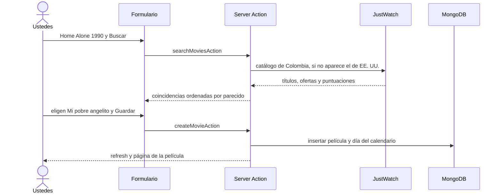

<div align="center">


# Navidad en casa

**Sus películas de Navidad en un solo lugar: dónde verlas en Colombia, cuáles ya vieron y un calendario de adviento con una película por día.**
Next.js 16 · MongoDB Atlas · datos automáticos de JustWatch, sin IA ni API keys de pago.


</div>

> *Escriben «Home Alone 1990» y la app trae «Mi pobre angelito» con póster, sinopsis, IMDb 7,8, Rotten Tomatoes 66 % y el botón «Ver en Disney+».*

## Contenido

- [Qué hace](#qué-hace)
- [Cómo funciona](#cómo-funciona)
- [Requisitos](#requisitos)
- [Variables de entorno](#variables-de-entorno)
- [Probarlo en local](#probarlo-en-local)
- [Configurar MongoDB Atlas](#configurar-mongodb-atlas)
- [Desplegar en Vercel](#desplegar-en-vercel)
- [Decisiones técnicas](#decisiones-técnicas)
- [Modelo de datos](#modelo-de-datos)
- [Estructura del proyecto](#estructura-del-proyecto)
- [Solución de problemas](#solución-de-problemas)
- [Hoja de ruta](#hoja-de-ruta)
- [Licencia y avisos](#licencia-y-avisos)

## Qué hace

- **Agregar con nombre y año.** Busca en JustWatch Colombia y trae el título latinoamericano, el póster, la sinopsis, los géneros, la duración, IMDb, el Tomatómetro (con Certified Fresh) y las plataformas con enlace directo a la película. Todo se puede editar a mano, incluida la opción «Sin plataforma».
- **Importar una lista completa.** Pegan «Título (año)» una por línea, revisan las coincidencias dudosas y guardan todas de una vez.
- **Marcar como vista** con un check verde animado y un sonido de campana (Web Audio, sin archivos). También tienen favoritas, calificación propia de 1 a 5 estrellas y notas.
- **Calendario de adviento.** Empieza «Desde hoy», el 1 de octubre, el 1 de noviembre, el 1 de diciembre, en la Novena (16–24 dic) o en una fecha propia, y termina el 24 de diciembre. Las películas se arrastran a cada día. Tiene modo sorpresa (los días futuros quedan cerrados como regalos), «Repartir automáticamente» (asigna todas las pendientes aunque cambien el rango de fechas), «Mezclar» y «Vaciar» con opción de deshacer. Los contadores de arriba distinguen días libres de películas sin día, y las películas vistas que no tienen día aparecen en el panel lateral para que ninguna quede escondida. Al abrir una puerta se ve la película en grande: póster, sinopsis completa, puntuaciones y todas las plataformas con su enlace.
- **Inicio que saluda** con «Buenos días», «Buenas tardes» o «Buenas noches» según la hora, cuenta los días que faltan para Nochebuena y muestra la película que toca hoy.
- **Diseño navideño:** logo de árbol de Navidad, modo claro y oscuro con transición de círculo, nieve, guirnalda de luces, tipografía de Apple (SF Pro / New York), pie de página con créditos y vista móvil con barra de pestañas.

<div align="center">

&nbsp;&nbsp;

</div>

<div align="center">

</div>

## Cómo funciona

La idea clave: **la app no guarda una copia "oficial" de nada externo**. Cuando agregan una película, el servidor le pregunta a JustWatch por el título y el año y les muestra las coincidencias. Lo que eligen se guarda en MongoDB y queda editable. El botón «Actualizar datos» vuelve a consultar los ratings y la disponibilidad, que cambian con el tiempo, sin tocar el título ni las notas que ustedes pusieron.





## Requisitos

| Qué | Para qué | Costo |
|---|---|---|
| **Node.js 22+** y **pnpm 10** | Correr, probar y construir | Gratis |
| **MongoDB Atlas** (clúster M0) | Guardar películas, calendario y ajustes | Gratis |
| **Vercel** (plan Hobby) | Publicarla en internet | Gratis |
| JustWatch | Pósters, sinopsis, ratings y plataformas en Colombia | Gratis, sin clave |
| OMDb *(opcional)* | Completar IMDb o Rotten Tomatoes cuando JustWatch no los trae | Gratis hasta 1.000 consultas al día |

## Variables de entorno

Copien [`.env.example`](.env.example) a `.env.local`, que git ignora.

| Variable | Obligatoria | Descripción |
|---|:-:|---|
| `MONGODB_URI` | ✅ | Cadena de conexión de Atlas (`mongodb+srv://…`). Ver [Configurar MongoDB Atlas](#configurar-mongodb-atlas). |
| `MONGODB_DB` | | Nombre de la base. Por defecto `christmas-movies`. |
| `APP_PASSWORD` | ✅ | La clave única para entrar a la app. Elijan una larga. |
| `AUTH_SECRET` | ✅ | Firma la cookie de sesión (mínimo 32 caracteres): `openssl rand -base64 32`. |
| `OMDB_API_KEY` | | Clave gratis de [omdbapi.com](https://www.omdbapi.com/apikey.aspx). |

> Los secretos viven solo en `.env.local` y en el panel de Vercel. **Nunca** se versionan.

## Probarlo en local

```bash
git clone https://github.com/jvrmmora/christmas-movies-select.git
cd christmas-movies-select
pnpm install
cp .env.example .env.local   # completen MONGODB_URI, APP_PASSWORD y AUTH_SECRET
pnpm dev                     # http://localhost:3000 → entren con APP_PASSWORD
```

**Ver la app llena sin tocar sus datos.** Esto carga 33 películas, 5 vistas y un calendario armado en una base aparte, `christmas-movies-demo`. El script se niega a escribir si el nombre de la base no contiene `demo`.

```bash
pnpm demo                                      # cargar datos de demo
MONGODB_DB=christmas-movies-demo pnpm dev      # abrir la app con esos datos
pnpm demo --limpiar                            # borrarlos
```

**Cargar la lista inicial en la base real**, si se clona de cero. Es idempotente: las películas que ya existen se saltan.

```bash
pnpm seed
```

**Pruebas y chequeos:**

```bash
pnpm test        # 22 pruebas: calendario y reparto automático, saludo, formato, lectura de listas y mapeo de JustWatch
pnpm lint
pnpm typecheck
pnpm build
```

## Configurar MongoDB Atlas

1. Creen una cuenta en [cloud.mongodb.com](https://cloud.mongodb.com) y un clúster **M0** (gratis).
2. En **Database Access**, creen un usuario con el rol `readWrite` solo sobre la base `christmas-movies`. No usen `root`.
3. En **Network Access**, agreguen `0.0.0.0/0`. Vercel no tiene IPs fijas, así que es necesario; la protección está en el usuario y la clave.
4. En **Connect → Drivers**, copien la cadena `mongodb+srv://…`, pongan la clave del usuario y péguenla en `MONGODB_URI`.

Los índices (título + año únicos por hogar, temporada del calendario) se crean solos la primera vez que la app se conecta.

## Desplegar en Vercel

**Desde GitHub (recomendado, cada push despliega solo):**

1. En [vercel.com/new](https://vercel.com/new), importen el repositorio `jvrmmora/christmas-movies-select`. Vercel detecta Next.js; no hay que cambiar nada del build.
2. En **Environment Variables**, agreguen `MONGODB_URI`, `MONGODB_DB`, `APP_PASSWORD`, `AUTH_SECRET` y, si la usan, `OMDB_API_KEY`.
3. **Deploy.** Abran la URL `*.vercel.app` y entren con `APP_PASSWORD`.

**Desde la terminal:**

```bash
npm i -g vercel
vercel login
vercel link
vercel env add MONGODB_URI production    # repetir con cada variable
vercel deploy --prod
```

> En Vercel la cookie de sesión es `Secure` y dura 30 días. Para cerrar todas las sesiones de una vez, cambien `AUTH_SECRET` y vuelvan a desplegar.

## Decisiones técnicas

| Decisión | Por qué |
|---|---|
| **JustWatch GraphQL con `language: "es-CO"`** en vez de IA o TMDB | Trae los títulos como se conocen en Colombia («Mi pobre angelito», no «Solo en casa»), las plataformas del país con enlace directo, IMDb y el Tomatómetro, sin clave ni costo. Es una API no oficial, así que todo queda editable y hay un botón para volver a consultar. |
| **Respaldo al catálogo de EE. UU.** | Algunos títulos («Aquella Navidad», de Netflix) no aparecen en el buscador de Colombia, aunque sí tienen datos y ofertas colombianas. |
| **Cache Components de Next 16**: shell estático + `<Suspense>` | Cada página carga al instante con esqueletos y los datos de Mongo llegan en streaming. Las mutaciones llaman `refresh()` y la UI responde al momento con `useOptimistic`. |
| **Una clave + cookie JWT (jose)** en lugar de cuentas | Por ahora es una sola casa. `proxy.ts` hace el control rápido, y cada lectura y cada Server Action vuelve a verificar la sesión. Todos los documentos llevan `ownerId`, listo para pasar a varios usuarios. |
| **La hora se calcula solo en el navegador** | El saludo, «Hoy toca» y la cuenta regresiva usan la zona horaria de ustedes, no la del servidor (UTC). Así se evitan errores de hidratación. |
| **dnd-kit** con colisión por puntero | El arrastre funciona con mouse y con el dedo (mantener presionado). Gana el día que está debajo del puntero, no el que más se superpone. Tocar un día vacío abre la lista como alternativa accesible. |
| **Sonidos sintetizados con Web Audio** | La campana, el *tick* y el *jingle* pesan 0 KB, no hay archivos que descargar y se silencian desde la cabecera. |
| **Logos oficiales** de IMDb, Rotten Tomatoes y plataformas | IMDb y Rotten Tomatoes están en `public/logos/` (Wikimedia Commons). Los de las plataformas son los íconos que entrega JustWatch. |

## Modelo de datos

```text
movies     { ownerId, title, originalTitle, year, posterUrl, backdropUrl, synopsis, genres[],
             runtimeMinutes, trailerUrl, ratings{imdb, rottenTomatoes, certifiedFresh},
             streaming[{provider, name, logoUrl, type: flatrate|free|ads|rent|buy, url}],
             externalIds{imdbId, tmdbId, justwatchId}, watched, watchedAt, favorite,
             myRating, notes, source: auto|manual, lastSyncedAt }   · único: ownerId+title+year
calendars  { ownerId, season, preset, startDate, endDate (24 dic), assignments{ "YYYY-MM-DD": movieId }, surprise }
settings   { ownerId, displayName }   · los nombres del saludo
```

## Estructura del proyecto

```
src/
├── proxy.ts                 # redirige a /login sin sesión válida
├── app/
│   ├── (app)/               # inicio, películas (lista, detalle, nueva, editar, importar), calendario
│   ├── login/               # pantalla de clave
│   └── globals.css          # paleta navideña (tokens claro/oscuro) y animaciones
├── actions/                 # Server Actions: auth, movies, calendar, settings
├── components/              # dashboard, movies, advent (calendario), shell (cabecera, nieve), ui
└── lib/
    ├── metadata/            # JustWatch (búsqueda y mapeo) y OMDb
    ├── dal.ts · db.ts       # acceso a datos con verificación de sesión · cliente de Mongo
    ├── calendar.ts          # rangos, celdas del mes, días libres
    └── *.test.ts            # pruebas con Vitest
scripts/                     # seed-list (lista inicial) y demo (datos de demostración)
public/logos/                # IMDb y Rotten Tomatoes
docs/                        # logo y capturas del README
```

## Solución de problemas

| Síntoma | Causa probable y arreglo |
|---|---|
| `MongoServerSelectionError` o *timeout* al entrar (en Vercel) | Atlas bloquea la IP. Agreguen `0.0.0.0/0` en **Network Access**. |
| `user is not allowed to do action […]` | El usuario de Atlas no tiene permisos sobre esa base. Denle `readWrite` sobre `christmas-movies` (y sobre `christmas-movies-demo` si usan el modo demo). |
| «La clave no está configurada en el servidor» | Falta `APP_PASSWORD` en el entorno. En Vercel, agréguenla y vuelvan a desplegar. |
| `AUTH_SECRET debe tener al menos 32 caracteres` | Generen uno con `openssl rand -base64 32`. |
| La búsqueda no encuentra una película | Prueben con el título original en inglés, o sin año. Si JustWatch no la tiene (por ejemplo, «In fraganti», 2009), elijan «Agregar sin datos» y completen a mano. |
| Una película no muestra IMDb o Rotten Tomatoes | JustWatch no lo tiene. Configuren `OMDB_API_KEY` y usen «Actualizar datos», o escríbanlo en «Editar». |
| No suena nada | El navegador solo permite audio después del primer toque. Revisen también que la campana de la cabecera no esté tachada (silencio). |

## Hoja de ruta

- [x] Lista con datos automáticos, importación y edición completa
- [x] Vistas, favoritas, calificación y notas
- [x] Calendario de adviento con arrastrar y soltar y modo sorpresa
- [x] Modo claro/oscuro, nieve, sonidos y vista móvil
- [ ] Cuentas por persona (Auth.js) para compartir la app con otras familias
- [ ] Recordatorio diario de «Hoy toca» (Vercel Cron + correo o push)
- [ ] Actualización automática semanal de plataformas y ratings

## Licencia y avisos

Código bajo licencia [MIT](LICENSE).

Datos de disponibilidad de [JustWatch](https://www.justwatch.com/co). IMDb, Rotten Tomatoes, Netflix, Disney+, Prime Video, HBO Max, Movistar TV y demás nombres y logos son marcas de sus dueños; se usan solo para identificar el servicio. Este proyecto **no está afiliado** a ninguno de ellos. Los pósters y las sinopsis pertenecen a sus estudios.
